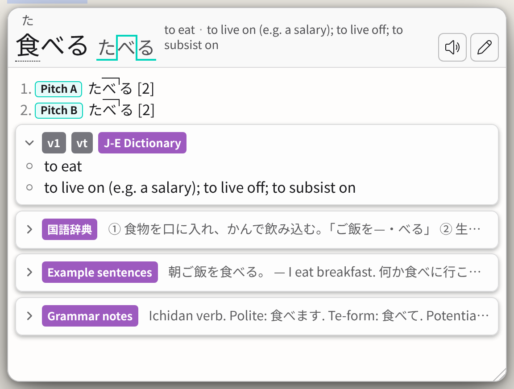

# Collapsible dictionaries

Folds each dictionary in Hachidori's popup to one line: a toggle, the
dictionary's name and tags, and the start of its first definition. A word with
many dictionaries then fits in a small popup, such as an overlay's, and you open
only the ones you want to read. Each word's first dictionary opens by itself.
Click a dictionary's row, or its toggle, to open or close it; it stays that way
for the next words until you reload the page.

## Use it

1. Install **Collapsible dictionaries** from Settings → Advanced → User
   scripts → Script Store, or add `script.js` and `script.css` there with
   **Import files**.
2. Let Hachidori run user scripts: Chrome's **Allow User Scripts** on
   Hachidori's details page, or **Allow user scripts** in Settings on Firefox.
3. Reload the pages you have open.

## Choose what starts open

The settings are at the top of `script.js`. Change them with **Edit** in User
scripts:

- `START`: `"first"` opens each word's first dictionary and closes the rest,
  `"all"` opens every dictionary and `"none"` closes every one.
- `ALWAYS_OPEN` and `ALWAYS_CLOSED`: dictionaries that always start open or
  closed, whatever `START` says, by the name the popup shows on their cards,
  such as `["Jitendex"]`.
- `REMEMBER`: `false` forgets the dictionaries you open or close, so every word
  starts as `START` says.

Saving an edit makes the script yours, so the Script Store no longer updates it.

## Where it works

In Hachidori's standard popup, in any colours, and in the search page's results.
The Theme Store's layouts (Nazeka, Plain, JL, Bee's Theme and Crystal) draw
dictionaries their own way, and the script leaves them as they are.

Requested in [bee-san/hachidori#671](https://github.com/bee-san/hachidori/issues/671).
