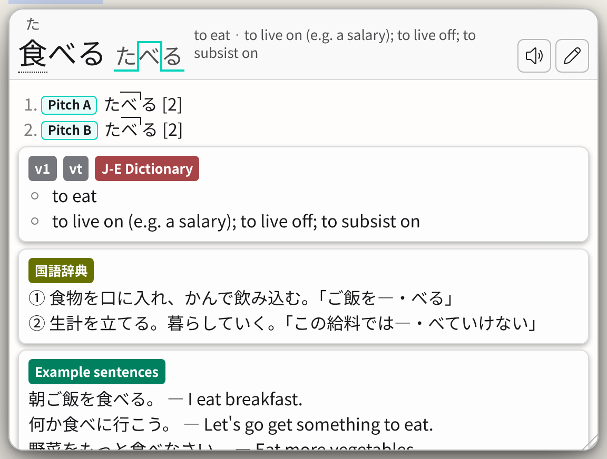

# Coloured dictionary names

Gives each dictionary's name on its cards a colour of its own, the same on
every word and every page, so you can tell your dictionaries apart at a glance.
The colours come from the dictionaries' names, and all of them keep the white
text readable (a contrast of at least 5:1). You can choose your own instead.



## Use it

1. Install **Coloured dictionary names** from Settings → Advanced → User
   scripts → Script Store, or add `script.js` and `script.css` there with
   **Import files**.
2. Let Hachidori run user scripts: Chrome's **Allow User Scripts** on
   Hachidori's details page, or **Allow user scripts** in Settings on Firefox.
3. Reload the pages you have open.

## Choose your own colours

`COLOURS`, at the top of `script.js`, takes a colour for any dictionary, by the
name the popup shows on its cards. Change it with **Edit** in User scripts, for
example:

```js
const COLOURS = { "Jitendex": "#b45309", "大辞林": "#1d4ed8" };
```

Any CSS colour works; choose one dark enough for white text. Saving an edit
makes the script yours, so the Script Store no longer updates it.

## Where it works

In Hachidori's standard popup, in any colours, and in the search page's results.
The Theme Store's layouts (Nazeka, Plain, JL, Bee's Theme and Crystal) show
dictionary names their own way, and the script leaves them as they are.

Suggested by [bee-san/hachidori#671](https://github.com/bee-san/hachidori/issues/671),
whose screenshots colour the dictionary names with custom CSS.
