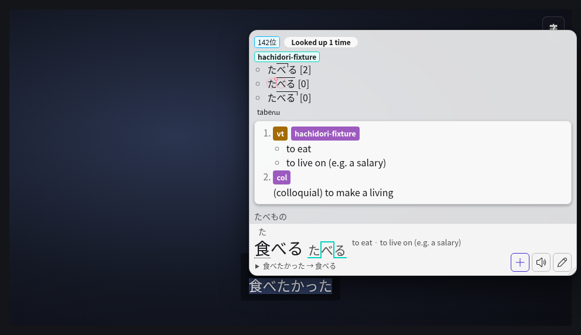

# Jimaku Player

Japanese subtitles on Crunchyroll, for reading them with Hachidori. The script
finds the episode you are watching on [jimaku.cc](https://jimaku.cc), lists its
Japanese subtitle files, and shows the one you pick over Crunchyroll's player.
Hover a line with Hachidori's activation key to look its words up, as anywhere
else.

It is [Jimaku Player Reloaded](https://github.com/mgp25/Jimaku-Player-Reloaded)
by mgp25, itself based on sheodox's
[Jimaku Player](https://github.com/sheodox/jimaku-player), adapted to run as a
Hachidori user script. The ISC licence is at the top of `script.js`.

## Set it up

1. Install **Jimaku Player** from Settings → Advanced → User scripts → Script
   Store, and let Hachidori run user scripts: Chrome's **Allow User Scripts**
   on Hachidori's details page, or **Allow user scripts** in Settings on
   Firefox.
2. Make a free account on [jimaku.cc](https://jimaku.cc) and copy your API key
   from [jimaku.cc/profile](https://jimaku.cc/profile).
3. Open an episode on Crunchyroll, press **J** (or click **字** at the top right
   of the player), open **Settings**, paste the key and **Save**. The script
   keeps it in crunchyroll.com's storage in this browser, where Crunchyroll's
   own page could read it, and sends it only to jimaku.cc.

Alternatively, edit the installed script in Hachidori's **Your scripts** and
paste your key between the quotes in `const JIMAKU_API_KEY = '';` near the top.
**Save script**, then reload Crunchyroll. This supplies the default when no key
has been saved in the player's Settings; a saved value takes precedence, even
if you saved an empty value. To change a previously saved key, use the player's
Settings.

Editing the installed script makes it your own copy, so the Script Store stops
offering updates for it. A key entered in the script is included wherever
Hachidori carries your user scripts, including backups and linked browsers.
Keep it out of shared scripts and commits. Loading a local subtitle file from
**File** needs no API key.

## Watch with subtitles

1. Press **J**. **Browse** has the show and episode filled in from the page;
   **Search**, then pick a file. Files tagged **WEB** usually match
   Crunchyroll's timing best. **File** loads a subtitle file from your
   computer instead.
2. If the lines are early or late, press **S** the moment a line starts being
   spoken: the current or next line snaps to that moment and the whole file
   moves with it. **B** goes back to the last line to check. **Z** and **X**
   move the subtitles 0.2 s earlier or later (1 s with Shift). The offset is
   remembered for the show, so later episodes start in sync.
3. **H** hides or shows the subtitles and **I** moves them to the top or the
   bottom.

## Mine with sentence audio and an animation

In a Hachidori newer than 0.5.0, switch on Settings → Advanced → Experimental
features → **Crunchyroll mining** and reload Crunchyroll. The script then gives
Hachidori the timing of the subtitles it shows, so a note mined from a line
gets:

- the whole line as its sentence;
- the line's audio for `{sentence-audio}`, cut from what you heard;
- a looping animation of the line for `{gif}`, as GIF, WebP or AVIF (Advanced →
  Video mining media), and `{screenshot}` of the video alone.

Hovering a line pauses the video until the pointer leaves the line and the
popup. The animation is recorded from the tab, so Chrome asks you to click
Hachidori's toolbar button once on the Crunchyroll tab first. Crunchyroll's
video is protected: if the audio comes out silent or the animation black,
turn off Chrome's **Use graphics acceleration when available**.

## Where it works

On Crunchyroll's watch pages (`www.crunchyroll.com/watch/…`), with Hachidori's
user scripts allowed; elsewhere the script does nothing. It was tried in
Chrome 152. Firefox records no line audio or animation for Crunchyroll
mining.

## What changed from Jimaku Player Reloaded

- It asks jimaku.cc with `fetch` instead of `GM_xmlhttpRequest`, which
  Hachidori's user scripts do not have; jimaku.cc allows Crunchyroll's pages
  to ask.
- It does nothing outside Crunchyroll, since Hachidori runs a script on every
  page.
- Clicking a line no longer opens jisho.org, because Hachidori looks it up.
- It marks its subtitles for Hachidori and hands it their timing for
  Crunchyroll mining.
